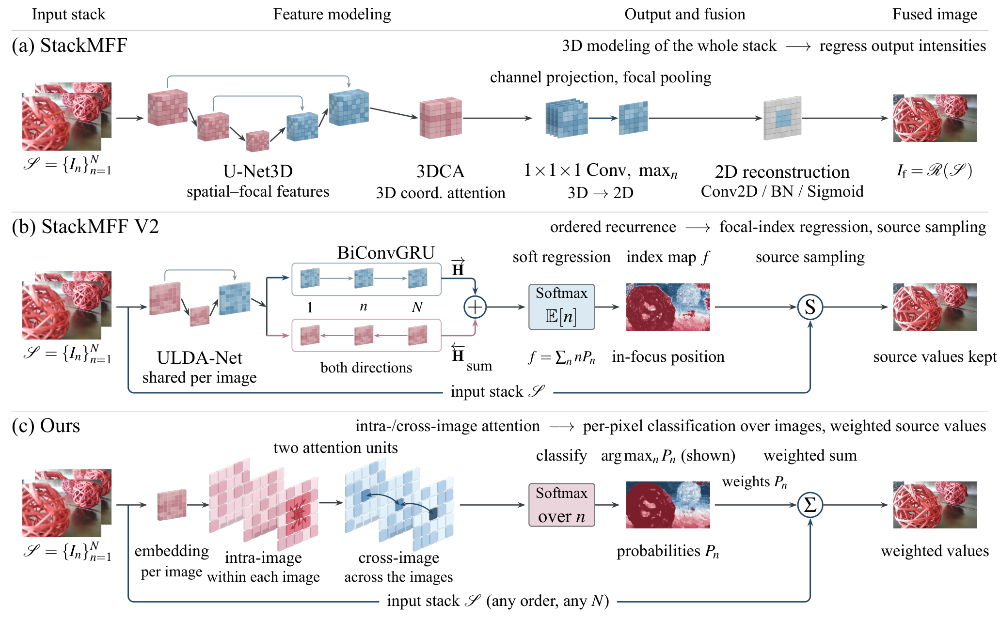

<div align="center">


# StackMFF Series

### Learning-based multi-focus image stack fusion: from end-to-end regression to order-free pixel-wise classification

[](https://github.com/Xinzhe99/StackMFF-Series)
[](https://github.com/Xinzhe99/StackMFF)
[](https://github.com/Xinzhe99/StackMFF-V2)
[](https://github.com/Xinzhe99/OpenFocus)
[](LICENSE)

</div>

---

> [!IMPORTANT]
> **2026-10 — StackMFF V3 and V4 have been unified.** The former StackMFF V3 (SSRN preprint) and StackMFF V4 (the
> deterministic stage of GMFF) were merged and redesigned into a single, new **StackMFF V3**: Modernizing Multi-Focus Image Stack Fusion.
> Its code, weights, evaluation toolkit and the fused results of the model are public in
> [StackMFF-V3](https://github.com/Xinzhe99/StackMFF-V3); the paper is under review. The old repositories are kept as
> read-only archives: [StackMFF-V3-legacy](https://github.com/Xinzhe99/StackMFF-V3-legacy),
> [StackMFF-V4-legacy](https://github.com/Xinzhe99/StackMFF-V4-legacy).
>

## Overview

A focal stack records the same scene at several focus positions; stack fusion merges it into one all-in-focus image.
The StackMFF series studies **learned fusion of whole stacks** instead of applying a two-image fusion network over and
over. Each version changes what the network predicts:

<div align="center">

</div>

| | What the network predicts | Order of the images | Output values |
|---|---|---|---|
| **StackMFF** | the fused intensities, by 3D convolutions over the whole stack | used (3D convolution) | regressed, may leave the recorded range |
| **StackMFF V2** | a continuous focal index per pixel, then samples the stack there | required (ordered focal sweep) | sampled from the stack |
| **StackMFF V3** | a probability over the *N* images per pixel (pixel-wise classification) | **not used** (permutation-equivariant) | probability-weighted combination of the recorded values, or hard selection |

## Projects

| Project | Idea | Paper | Code | Status |
|---|---|---|---|---|
| **StackMFF** | end-to-end 3D network for stack fusion | [Applied Intelligence 2025](https://link.springer.com/article/10.1007/s10489-025-06383-8) | [StackMFF](https://github.com/Xinzhe99/StackMFF) | ✅ published |
| **StackMFF V2** | one-shot fusion by focal-depth regression | [EAAI 2025](https://www.sciencedirect.com/science/article/abs/pii/S0952197625026983) | [StackMFF-V2](https://github.com/Xinzhe99/StackMFF-V2) | ✅ published |
| **StackMFF V3** (unified) | pixel-wise classification over the images with a permutation-equivariant attention network | StackMFF V3: Modernizing Multi-Focus Image Stack Fusion | [StackMFF-V3](https://github.com/Xinzhe99/StackMFF-V3) | 📝 under review; code and results released |
| *Archived* | GMFF: generative restoration on top of deterministic stack fusion (its deterministic stage was StackMFF V4) | [arXiv 2512.21495](https://arxiv.org/abs/2512.21495) | [GMFF](https://github.com/Xinzhe99/GMFF) | 🗄️ deprecated, superseded by the unified V3 |
| **OpenFocus** | open-source focus stacking software (GUI + CLI) | — | [OpenFocus](https://github.com/Xinzhe99/OpenFocus) | ✅ released |
| *Archived* | former StackMFF V3 / StackMFF V4 | [SSRN 5954614](https://papers.ssrn.com/sol3/papers.cfm?abstract_id=5954614) | [V3-legacy](https://github.com/Xinzhe99/StackMFF-V3-legacy), [V4-legacy](https://github.com/Xinzhe99/StackMFF-V4-legacy) | 🗄️ superseded by the unified V3 |

### What happened to StackMFF V3 and V4?

The former StackMFF V3 introduced the classification formulation with a convolutional network; StackMFF V4 improved
the network and served as the deterministic stage of GMFF. Both were developed in parallel and were never published
in a journal. We merged them into one study, replaced the network by an attention network that does not use the
order of the images, re-designed the training data synthesis and the loss, and re-evaluated all methods with one
toolkit. The result is the unified **StackMFF V3**; it supersedes both earlier versions.

## Latest results

All methods re-evaluated from their result images with one toolkit (cross-checked against MATLAB references) on four
stack benchmarks. SSIM / PSNR (dB), higher is better. From the StackMFF V3 paper; the full table with all 32 methods, five
full-reference and two no-reference metrics is in the paper and the [StackMFF-V3](https://github.com/Xinzhe99/StackMFF-V3) repository.

| Method | Mobile Depth | Middlebury | FlyingThings3D | Road-MF |
|---|---|---|---|---|
| StackMFF | 0.9470 / 32.13 | 0.9336 / 30.90 | 0.9568 / 32.99 | 0.9715 / 33.19 |
| StackMFF V2 | 0.9510 / 35.21 | 0.9453 / 32.18 | 0.9531 / 32.75 | 0.9811 / 36.27 |
| **StackMFF V3** (weighted) | **0.9855 / 40.16** | **0.9622 / 34.28** | **0.9722 / 35.35** | 0.9979 / 44.53 |
| **StackMFF V3** (hard selection) | 0.9769 / 38.36 | 0.9595 / 33.59 | 0.9692 / 34.79 | **0.9984 / 46.12** |

| Method | Params (M) | GFLOPs (two 256×256 images) | Time per stack (s, RTX A6000) | Change under random image order |
|---|---|---|---|---|
| StackMFF | 6.08 | 37.37 | 0.33 | small (≤ 0.004 SSIM) |
| StackMFF V2 | 0.05 | 5.50 | 0.10 | −0.166 SSIM, −7.9 dB |
| **StackMFF V3** | 0.16 | 1.94 (3.03 with two inference scales) | 0.10 (0.16) | **none (identical output)** |


## OpenFocus

<a href="https://github.com/Xinzhe99/OpenFocus"><b>OpenFocus</b></a> is our free, open-source focus stacking program
for Windows and macOS: image registration (including hand-held bursts), classical and learned fusion, batch processing,
tiled processing of large images, 16-bit and camera RAW input, a retouch tool and a command-line interface. The
StackMFF models are being integrated into it. If you work in microscopy, macro photography or inspection, give it a try.

## Citation

If the StackMFF series helps your research, please cite the relevant work(s):

```bibtex
@article{xie2025stackmff,
  title   = {StackMFF: end-to-end multi-focus image stack fusion network},
  author  = {Xie, Xinzhe and Qingyan, Jiang and Chen, Dong and Guo, Buyu and Li, Peiliang and Zhou, Sangjun},
  journal = {Applied Intelligence},
  volume  = {55},
  number  = {6},
  pages   = {503},
  year    = {2025}
}

@article{xie2025stackmffv2,
  title   = {One-shot multi-focus image stack fusion via focal depth regression},
  author  = {Xie, Xinzhe and Guo, Buyu and He, Shuangyan and Gu, Yanzhen and Li, Yanjun and Li, Peiliang},
  journal = {Engineering Applications of Artificial Intelligence},
  volume  = {162},
  pages   = {112667},
  year    = {2025}
}

@article{xie2026stackmffv3,
  title   = {StackMFF V3: Modernizing Multi-Focus Image Stack Fusion},
  author  = {Xie, Xinzhe and others},
  note    = {Under review},
  year    = {2026}
}

@article{xie2025gmff,
  title   = {Generative Multi-Focus Image Fusion},
  author  = {Xie, Xinzhe and Guo, Buyu and Li, Bolin and He, Shuangyan and Gu, Yanzhen and Jiang, Qingyan and Li, Peiliang},
  journal = {arXiv preprint arXiv:2512.21495},
  year    = {2025}
}
```

## Contact

Xinzhe Xie, Zhejiang University — [xiexinzhe@zju.edu.cn](mailto:xiexinzhe@zju.edu.cn). Questions and bug reports:
please open an issue in the corresponding repository.

<div align="center">

**If you find this series useful, please ⭐ star [StackMFF](https://github.com/Xinzhe99/StackMFF),
[StackMFF V2](https://github.com/Xinzhe99/StackMFF-V2), [StackMFF V3](https://github.com/Xinzhe99/StackMFF-V3),
[OpenFocus](https://github.com/Xinzhe99/OpenFocus) and this page. Thank you!**

</div>
